<div align="center">


# find-agent-pane

tmux 창마다 어떤 코딩 에이전트가 돌고 있는지 알려 주는 명령줄 도구입니다.

[English](README.md) · Python 3.9+ · 의존성 없음

[](https://github.com/elfenomenokim/find-agent-pane/actions/workflows/tests.yml)
[](https://pypi.org/project/find-agent-pane/)
[](LICENSE)

[설치](#설치) · [빠르게 써 보기](#빠르게-써-보기) · [판별 방법](#판별-방법) · [에이전트](#에이전트) · [참고](#참고)

</div>

에이전트 14종을 실제 창에서 확인 · macOS·Linux 실제 세션에서 뜬 시험 창 51개 · 실행 한 번에 `ps` 한 번, `tmux` 한 번

```console
$ find-agent-pane --all-servers
%57   fenok-next:1.1   claude    22201     ~/…/claude-code-hub     resume=2318a67c-730
%15   fenok-next:1.1   codex     89823     ~/…/00_Workspace_Ops    resume=01a19b70-8ad
%0    fap:1.1          gemini    3140370   /tmp/fap-agents/work
%1    -                unknown   -         -                       2 owners: gemini 200, aider 300
```

<sub>세 대의 기기(맥 미니 M5, 맥 미니 M4, Linux 시험 서버)의 실제 창에서 뽑은 줄입니다(경로는 줄임). 마지막 줄은 주인이 둘인 시험 자료입니다.</sub>

<p align="center">
  <picture>
    <source media="(prefers-color-scheme: dark)" srcset="https://raw.githubusercontent.com/elfenomenokim/find-agent-pane/main/docs/diagrams/owner.ko.dark.svg">
    
  </picture>
</p>

## 필요한 이유

tmux에서 코딩 에이전트 여러 개를 함께 돌리면, 스크립트가 어느 창이 무엇인지 알아야 합니다.
Codex 창에 메시지를 보내거나, 사고 뒤 맞는 세션을 다시 이어 붙이거나, 상태 줄을 보여 줄 때입니다.
가장 쉬운 방법인 `ps -t <tty> | grep claude`는 첫 주에 깨집니다.

- 실행기(`zsh -lic ccd`, `env FOO=1 codex`)가 실제 프로그램을 가립니다.
- Claude Code는 프로세스 이름을 버전 숫자로 바꾸고, 자식 프로세스도 같은 이름을 물려받습니다.
- 에이전트가 띄운 MCP 서버나 다른 에이전트가 주인처럼 보입니다.
- 어떤 에이전트는 자기를 다시 띄워서 같은 프로그램이 두 번 나타납니다.
- `exec -a claude bash`로 띄운 셸은 이름은 claude지만 에이전트가 아닙니다.

find-agent-pane은 프로세스 근거만으로 답합니다. 에이전트에 훅이나 플러그인을 깔 필요가 없고,
상태 파일도 쓰지 않습니다. 애매하면 추측하지 않고 `unknown`과 후보를 보여 줍니다.

| | find-agent-pane | 훅 기반 표시기 ([tmux-agent-indicator](https://github.com/accessd/tmux-agent-indicator), [tmux-agent-status](https://github.com/samleeney/tmux-agent-status)) | 관리 도구 ([claude-squad](https://github.com/smtg-ai/claude-squad), [tmux-agent-plane](https://github.com/zazencodes/tmux-agent-plane)) |
|---|---|---|---|
| 직접 띄운 창 | 됨 | 됨, 에이전트마다 훅 설치 후 | 안 됨, 자기가 띄운 창만 |
| 에이전트 협조 필요 | 아니오 | 예(훅·플러그인) | 아니오 |
| 훅이 없을 때 | 아래 규칙으로 프로세스 트리 판별 | `ps -t <tty> \| grep -w 이름` | 해당 없음 |
| 실행 중/대기 상태 | 모름 | 앎 | 앎 |

실행 중인지 기다리는지 알고 싶다면 훅 기반 표시기를 쓰세요. 관리 도구 없이 직접 띄운 창에서
*어느 에이전트가 어느 창의 주인인지* 알아야 할 때 find-agent-pane을 쓰면 됩니다.

## 설치

```sh
uv tool install find-agent-pane     # 또는: pipx install find-agent-pane
```

`pip install find-agent-pane`도 됩니다. Python 3.9 이상, macOS와 Linux를 지원합니다.

## 빠르게 써 보기

```sh
find-agent-pane                    # 현재 tmux 서버의 에이전트 창
find-agent-pane --all-servers      # 내가 띄운 모든 tmux 서버(-S 소켓 경로 포함)
find-agent-pane --agent codex      # Codex 창만 (여러 번 지정 가능)
find-agent-pane --all              # 에이전트가 없는 창도 표시
find-agent-pane --json             # 창마다 JSON 한 줄, 스크립트용
```

Codex 창에 메시지 보내기:

```sh
pane=$(find-agent-pane --agent codex --json | head -1 | python3 -c 'import json,sys;print(json.load(sys.stdin)["pane_id"])')
tmux send-keys -t "$pane" 'run the tests' Enter
```

열은 차례로 창 ID, `세션:창.칸`, 에이전트, 주인 PID, 작업 폴더, 세션 ID 힌트, 창 제목입니다.
에이전트 뒤의 `*`는 `claude -p` 같은 일회성 실행입니다. `unknown` 줄에는 후보가 모두 나옵니다.

## 판별 방법

1. **한 번에 읽기.** `ps -ww -e`와 `tmux list-panes -a`를 한 번씩 읽고, 묶음 세션 중복은 지웁니다.
2. **실행 파일로만 판별.** 프로세스 이름, 그다음 `argv[0]`, 그다음 런타임(`node`, `bun`, `deno`,
   `python`)이 실행하는 스크립트를 봅니다. 뒤에 오는 인자는 근거가 아닙니다. Claude를 언급하는
   Codex 프롬프트도 Codex입니다.
3. **실행기 벗기기.** `env A=1 X`, `sh -c X`, `zsh -lic X`. 셸의 `argv[0]`은 `-c`로 프로그램을
   지정할 때만 봅니다. 그래서 `exec -a claude bash`는 셸입니다.
4. **버전 숫자 이름은 `argv[0]`을 따릅니다.** Claude Code가 자기 이름을 버전으로 바꾸기 때문입니다.
5. **보조 프로세스는 작업.** 에이전트 아래의 일회성 플래그(`-p`, `--print`), 보조 명령(`mcp-server`,
   `exec`, `app-server`, `run`), 도구 런타임은 제외합니다. 창에 보조 실행만 있으면 그것이 그 창의
   에이전트이고, 일회성 실행으로 표시합니다.
6. **가지마다 가장 바깥 주인.** 다른 에이전트가 도구 호출로 띄운 에이전트는 작업입니다.
7. **같은 에이전트 사슬 정리.** 감싼 실행기는 실제 프로그램에 주인 자리를 넘깁니다(`node … crush`
   → `crush`). 실행 파일이 같은 자식은 복제(Gemini는 자기를 다시 띄움)라서 부모가 주인입니다.
8. **주인이 둘이면 앞쪽 하나, 아니면 `unknown`.** 주인 하나만 앞에서 실행 중(`pgid == tpgid`)이고
   나머지가 모두 멈춰 있으면 그 하나를 고릅니다. 그 밖에는 `unknown`입니다.

## 에이전트

아래 에이전트는 모두 실제 tmux 창에서 띄워 프로세스 트리를 확인했습니다.

| 에이전트 | 알아보는 방법 |
|---|---|
| Claude Code | `claude` (네이티브 실행 파일 또는 `@anthropic-ai/claude-code`) |
| OpenAI Codex | `codex` (npm 실행기 또는 네이티브 실행 파일) |
| Gemini CLI | `node …/@google/gemini-cli/…` |
| Qwen Code | `node …/@qwen-code/qwen-code/…` |
| OpenCode | `opencode` |
| Amp | `amp` |
| Crush | `crush` (npm 실행기를 거침) |
| GitHub Copilot CLI | `copilot` (npm 실행기를 거침) |
| Cursor CLI | `cursor-agent` |
| Goose | `goose` |
| Aider | `aider` |
| Kimi Code | `kimi`, `kimi-code` |
| Antigravity | `agy`, `antigravity` |
| pi | `pi` |

직접 쓰는 에이전트나 실행기 별칭은 `~/.config/find-agent-pane/agents.json`에 넣거나
`--agents FILE`로 넘기면 됩니다. 형식은 기본 [agents.json](find_agent_pane/agents.json)과 같습니다.

```json
{"families": {"myagent": {"executables": ["myagent"], "aliases": ["ma"], "entry_patterns": [],
  "helper_flags": ["--batch"], "helper_subcommands": [], "resume_patterns": []}}}
```

## 참고

```
find-agent-pane [--agent NAME]... [--json] [--all] [-L NAME | -S PATH | --all-servers]
                [--agents FILE]... [--version]
```

JSON 필드: `pane_id`, `server`, `target`, `family`, `owner_pid`, `headless`, `cwd`,
`session_hint`, `title`, `evidence`, `candidates`.

Python에서:

```python
from find_agent_pane import Table, resolve_pane
from find_agent_pane.cli import snapshot

verdict = resolve_pane(pane_pid, snapshot(), Table.load())
verdict.family, verdict.owner_pid, verdict.session_hint
```

## 한계

- 창의 주인은 알려 주지만, 에이전트가 일하는 중인지 기다리는 중인지는 모릅니다.
- 소켓 파일이 지워진 tmux 서버의 창은 목록을 읽을 수 없습니다.
- Linux와 macOS만 지원하고, `PATH`에 tmux가 있어야 합니다.
- 표에 없는 에이전트는 알아보지 못합니다. 위처럼 직접 추가하세요.

## 기여

잘못 판별한 창이 가장 좋은 기여입니다. 시험 자료로 남기는 방법은 [CONTRIBUTING.md](CONTRIBUTING.md)에 있습니다.

## 라이선스

[MIT](LICENSE)
