<div align="center">


# find-agent-pane

A command-line tool that lists your tmux panes with the coding agent running in each one.

[한국어](README.ko.md) · Python 3.9+ · no dependencies

[](https://github.com/elfenomenokim/find-agent-pane/actions/workflows/tests.yml)
[](https://pypi.org/project/find-agent-pane/)
[](LICENSE)

[Install](#install) · [Quick start](#quick-start) · [How it decides](#how-it-decides) · [Agents](#agents) · [Reference](#reference)

</div>

14 agents, each identified in a live pane · 51 test panes from real macOS and Linux sessions · one `ps` and one `tmux` call per run

```console
$ find-agent-pane --all-servers
%57   fenok-next:1.1   claude    22201     ~/…/claude-code-hub     resume=2318a67c-730
%15   fenok-next:1.1   codex     89823     ~/…/00_Workspace_Ops    resume=01a19b70-8ad
%0    fap:1.1          gemini    3140370   /tmp/fap-agents/work
%1    -                unknown   -         -                       2 owners: gemini 200, aider 300
```

<sub>Rows from real panes on three machines (Mac mini M5, Mac mini M4, a Linux test host; paths shortened). The last row is the two-owner test fixture.</sub>

<p align="center">
  <picture>
    <source media="(prefers-color-scheme: dark)" srcset="https://raw.githubusercontent.com/elfenomenokim/find-agent-pane/main/docs/diagrams/owner.dark.svg">
    
  </picture>
</p>

## Why

When several coding agents run in tmux, scripts need to know which pane is which: to send a
message to the Codex pane, to resume the right session after a crash, to show a status line. The
obvious check, `ps -t <tty> | grep claude`, breaks the first week:

- a launcher (`zsh -lic ccd`, `env FOO=1 codex`) hides the real program;
- Claude Code renames its process to its version number, and its children inherit that name;
- an agent's MCP servers and the other agents it starts look like owners;
- some agents re-exec themselves, so the same program appears twice;
- a shell started as `exec -a claude bash` is named claude but is not.

find-agent-pane answers from process evidence alone. It needs no hooks in the agents, no plugin,
and no state file, and it reports `unknown` with the candidates instead of guessing.

| | find-agent-pane | Hook-based indicators ([tmux-agent-indicator](https://github.com/accessd/tmux-agent-indicator), [tmux-agent-status](https://github.com/samleeney/tmux-agent-status)) | Managers ([claude-squad](https://github.com/smtg-ai/claude-squad), [tmux-agent-plane](https://github.com/zazencodes/tmux-agent-plane)) |
|---|---|---|---|
| Panes you started yourself | yes | yes, after installing hooks per agent | no, only panes they launched |
| Needs agent cooperation | no | yes (hooks or plugins) | no |
| Without hooks | process tree with the rules below | `ps -t <tty> \| grep -w name` | n/a |
| Running / waiting state | no | yes | yes |

Use a hook-based indicator if you want running/waiting state. Use find-agent-pane when you need to
know *which agent owns which pane* in panes you did not launch through a manager.

## Install

```sh
uv tool install find-agent-pane     # or: pipx install find-agent-pane
```

`pip install find-agent-pane` works too. Python 3.9 or newer; macOS and Linux.

## Quick start

```sh
find-agent-pane                    # agent panes on the current tmux server
find-agent-pane --all-servers      # every tmux server you run, including -S socket paths
find-agent-pane --agent codex      # only Codex panes (repeatable)
find-agent-pane --all              # include panes with no agent
find-agent-pane --json             # one JSON object per pane, for scripts
```

Send a message to the Codex pane:

```sh
pane=$(find-agent-pane --agent codex --json | head -1 | python3 -c 'import json,sys;print(json.load(sys.stdin)["pane_id"])')
tmux send-keys -t "$pane" 'run the tests' Enter
```

Columns: pane id, `session:window.pane`, agent (`*` marks a headless run such as `claude -p`),
owner pid, working directory, session hint, pane title. `unknown` rows show every candidate.

## How it decides

1. **One snapshot.** `ps -ww -e` and `tmux list-panes -a`, deduplicated across grouped sessions.
2. **Executable identity only.** The process name, then `argv[0]`, then the script a runtime
   (`node`, `bun`, `deno`, `python`) runs. Later arguments are never identity: a Codex prompt that
   mentions Claude stays Codex.
3. **Launchers are unwrapped.** `env A=1 X`, `sh -c X`, `zsh -lic X`. A shell's own `argv[0]` is
   ignored unless it names a program with `-c`, so `exec -a claude bash` is a shell.
4. **Version-shaped names defer to `argv[0]`**, because Claude Code renames itself to its version.
5. **Helpers are work, not owners.** Headless flags (`-p`, `--print`), helper subcommands
   (`mcp-server`, `exec`, `app-server`, `run`) and tool runtimes below an agent are ignored. A
   helper alone in a pane is that pane's agent, marked headless.
6. **Outermost owner per branch.** An agent started by another agent's tool call is work.
7. **Same-agent chains collapse.** A shim hands ownership to the real binary (`node … crush` →
   `crush`); a child with the same executable is a clone (Gemini re-execs itself) and the parent
   keeps ownership.
8. **Two owners: the foreground one, or `unknown`.** When exactly one owner is in the foreground
   (`pgid == tpgid`) and the others are stopped, it wins. Otherwise the pane is `unknown`.

## Agents

Every family below was launched in a real tmux pane and its process tree checked.

| Agent | Recognised as |
|---|---|
| Claude Code | `claude` (native binary or `@anthropic-ai/claude-code`) |
| OpenAI Codex | `codex` (npm shim or native binary) |
| Gemini CLI | `node …/@google/gemini-cli/…` |
| Qwen Code | `node …/@qwen-code/qwen-code/…` |
| OpenCode | `opencode` |
| Amp | `amp` |
| Crush | `crush` (through its npm shim) |
| GitHub Copilot CLI | `copilot` (through its npm shim) |
| Cursor CLI | `cursor-agent` |
| Goose | `goose` |
| Aider | `aider` |
| Kimi Code | `kimi`, `kimi-code` |
| Antigravity | `agy`, `antigravity` |
| pi | `pi` |

Add your own agent or launcher alias in `~/.config/find-agent-pane/agents.json` (same shape as
the bundled [agents.json](find_agent_pane/agents.json)), or pass `--agents FILE`:

```json
{"families": {"myagent": {"executables": ["myagent"], "aliases": ["ma"], "entry_patterns": [],
  "helper_flags": ["--batch"], "helper_subcommands": [], "resume_patterns": []}}}
```

## Reference

```
find-agent-pane [--agent NAME]... [--json] [--all] [-L NAME | -S PATH | --all-servers]
                [--agents FILE]... [--version]
```

JSON fields: `pane_id`, `server`, `target`, `family`, `owner_pid`, `headless`, `cwd`,
`session_hint`, `title`, `evidence`, `candidates`.

Python:

```python
from find_agent_pane import Table, resolve_pane
from find_agent_pane.cli import snapshot

verdict = resolve_pane(pane_pid, snapshot(), Table.load())
verdict.family, verdict.owner_pid, verdict.session_hint
```

## Limits

- It says who owns a pane, not whether the agent is working or waiting.
- Panes of a tmux server whose socket file was deleted cannot be listed.
- On Linux and macOS only; tmux must be on `PATH`.
- An agent that is not in the table is not recognised; add it as shown above.

## Contributing

A pane it got wrong is the best contribution: see [CONTRIBUTING.md](CONTRIBUTING.md) for how to
capture it as a fixture.

## License

[MIT](LICENSE)
